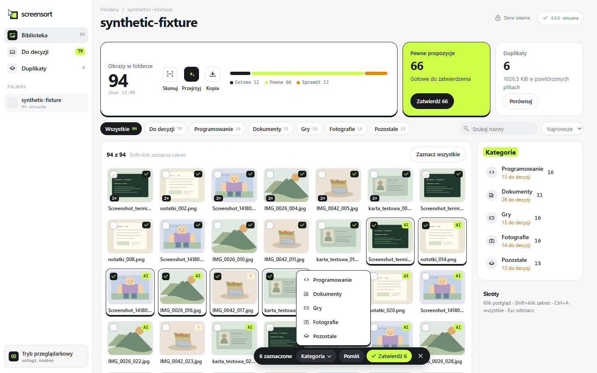
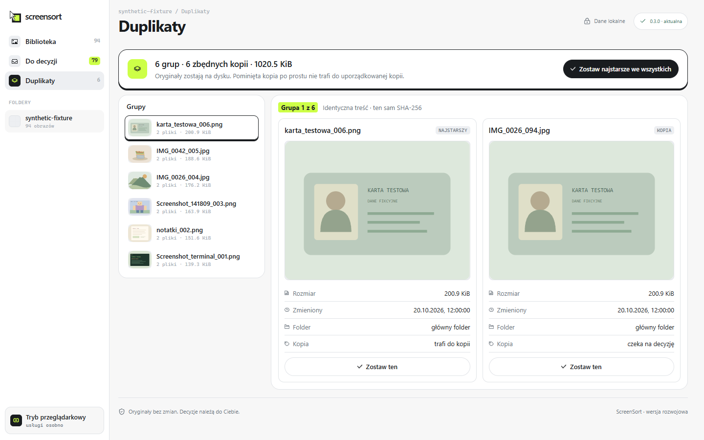

<div align="center">

# screensort

**Turn a folder of screenshot chaos into named, sorted copies — on your own computer.**


[**Download**](https://github.com/Pum2A/screensort-releases/releases) ·
[How it works](#how-it-works) ·
[Architecture](#architecture) ·
[Development](docs/development.md) ·
[What's next](docs/v1-plus-do-zrobienia.md)


</div>

## What it does

ScreenSort scans a folder of images and reads each one with **local** OCR and a vision model.
From that, it proposes a **name** and a **category**. You approve, fix or skip them, many at
once, and ScreenSort then writes a **sorted copy** into category folders.

- 🔒 **Nothing leaves your computer.** The models run on your CPU. There is no cloud API and no upload.
- 🗂️ **Originals are never touched.** ScreenSort never renames, moves or deletes a source file. Only approved images are copied, and each copy is checked against its SHA-256.
- ⚡ **Built for bulk.** Select many images (Shift+click, Ctrl+A), set a category with keys 1–5, and approve them all at once.
- 🧩 **Finds duplicates.** Byte-identical files are grouped, and you choose which copy goes into the sorted folder.

> **Status:** working preview for Windows x64. The AI proposals are a first version and
> need your review. This is an ongoing personal project, not a finished product.

## Screens

| Bulk actions | Bulk review |
| --- | --- |
|  |  |
| Select a range and set the category, skip or approve from one bar. | Every proposal of the folder on one screen; keys 1–5 pick a category. |



<sub>Screenshots of the real interface, running on synthetic demo images.</sub>

## How it works

```text
choose folder → scan & catalog → local OCR + image description
             → name & category proposals → your decisions (one by one or in bulk)
             → verified, sorted copy in a new folder
```

1. **Scan.** Java validates the folder and catalogs PNG/JPG files in PostgreSQL. It hashes them (SHA-256) and skips unchanged files on the next scan.
2. **Analyse.** On request, Java sends image bytes to a local Python service. RapidOCR reads the text and Florence-2 describes the picture. Results are saved per file, and the analysis can be paused and resumed.
3. **Propose.** Simple, deterministic rules turn the text and the description into a filename and one of five categories. Uncertain proposals are marked "Sprawdź" (check).
4. **Decide.** In the library or the bulk review you approve, recategorise or skip. Decisions are versioned, so an outdated form can never overwrite a newer one.
5. **Copy.** ScreenSort copies the approved files into category folders and verifies each one against its hash. Existing files at the destination are never overwritten.

## Architecture

```text
┌──────────── Tauri 2 (Rust) ─────────────┐
│ window · folder picker · process owner  │
│  ┌────────── React 19 UI ────────────┐  │
│  │ TanStack Query · Zod · Tailwind 4 │  │
│  └──────────────┬────────────────────┘  │
└─────────────────┼───────────────────────┘
                  │ REST (loopback)
        ┌─────────▼─────────┐        ┌───────────────────────┐
        │ Java 25 · Spring  │──bytes▶│ Python · FastAPI      │
        │ Boot 4 · Flyway   │◀─JSON──│ RapidOCR · Florence-2 │
        └─────────┬─────────┘        └───────────────────────┘
                  │
           ┌──────▼──────┐
           │ PostgreSQL  │  private instance, started by the app
           └─────────────┘
```

| Part | Responsibility | Technology |
| --- | --- | --- |
| Desktop shell | Window, native dialogs, starts and stops local services, in-app updates | Tauri 2, Rust |
| Interface | Library, bulk review, duplicates, previews, progress | React 19, TypeScript, TanStack Query, Zod, Tailwind 4, Motion |
| Backend | Scanning, catalog, analysis jobs, decisions, verified copying | Java 25, Spring Boot 4, JdbcTemplate/JPA, Flyway |
| Database | Catalog, analyses, decisions, copy jobs | PostgreSQL |
| Analysis | OCR and image description on CPU | Python, FastAPI, RapidOCR, Florence-2-base-ft |
| Quality | Unit, integration and UI tests in CI | JUnit 5, Testcontainers, node:test, cargo test, pytest, ruff |

Credentials and loopback ports stay in Rust, outside the web view. Java alone opens source
files: Python receives image bytes, never file paths, and logs never contain paths, file names
or OCR text.

## Install

Download the installer from the [distribution repository](https://github.com/Pum2A/screensort-releases/releases).
It needs no separately installed JDK, Python, Node or Docker. The AI engine is an optional
download from inside the app, checked against a pinned SHA-256. Updates are signed and
installed from inside the app.

<sub>The installer is not Authenticode-signed yet, so Windows SmartScreen may warn on first launch.</sub>

## Development

```bash
./mvnw spring-boot:run -Dspring-boot.run.profiles=local   # backend; starts PostgreSQL via Docker Compose
npm --prefix frontend ci && npm --prefix frontend run dev  # interface on http://localhost:5173
```

Full setup, tests and packaging: [docs/development.md](docs/development.md) ·
[Windows installer](docs/instalator-windows.md) · [analysis service](analysis-service/README.md).

## Project notes

- [What v1+ still lacks](docs/v1-plus-do-zrobienia.md): the open work, one future issue per section (Polish).
- [Current state and known gaps](docs/current-state.md) (Polish).
- [Code structure](docs/struktura-projektu.md) · [technical decisions](docs/decyzje-techniczne.md) · [ADRs](docs/adr).
- [Scan jobs walkthrough](docs/scanjob-krok-po-kroku.md) · [image analysis walkthrough](docs/analiza-obrazu-krok-po-kroku.md).

Older guides in `docs/` describe the project at their stated date and may mention screens that
the v1+ redesign has replaced.
