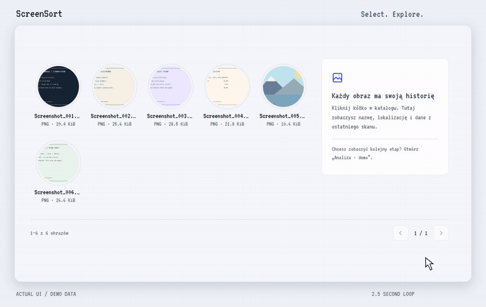
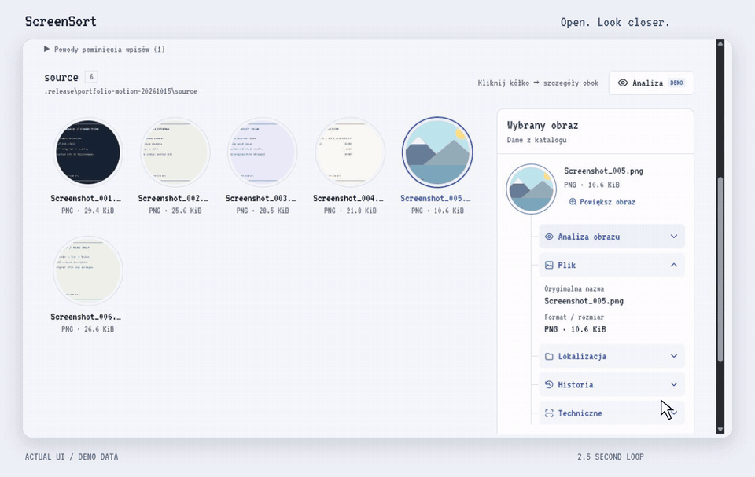
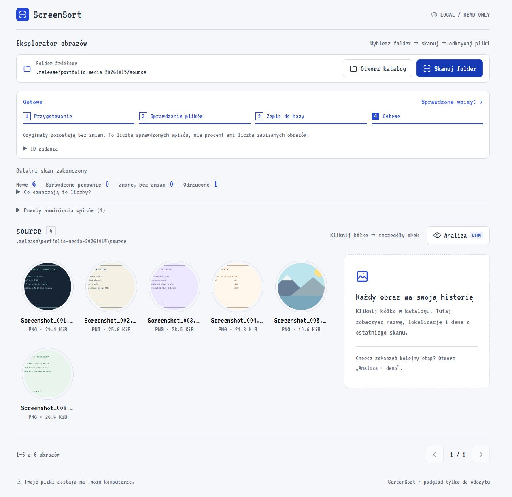
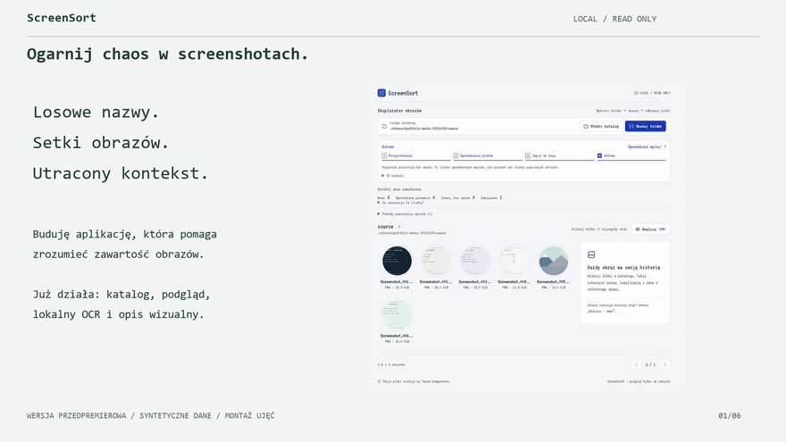
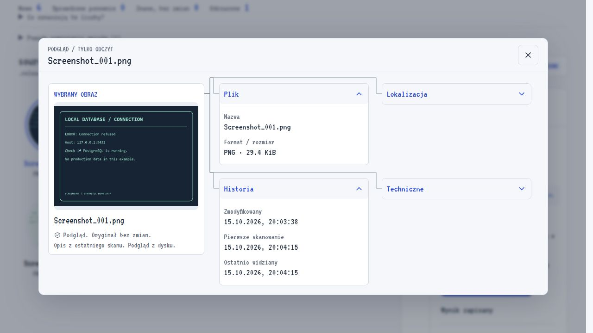
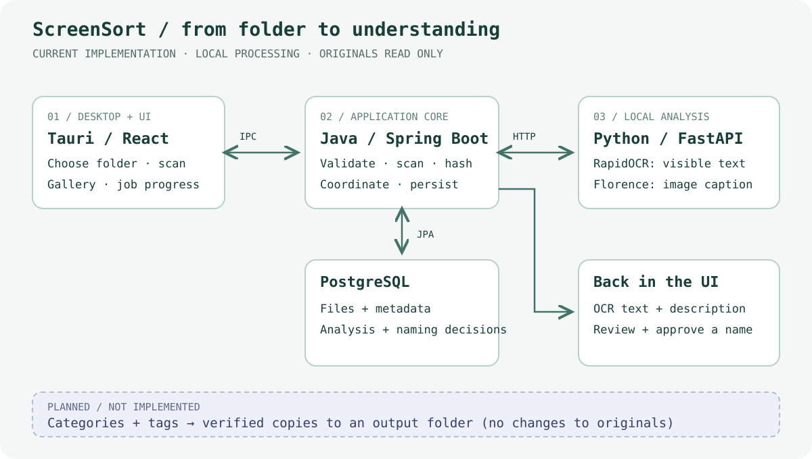

# ScreenSort

### Make sense of your screenshot chaos.

A local-first Windows application for exploring screenshot folders and understanding
what is inside each image. Choose a folder, build a persistent catalog, then run
local OCR and visual analysis without uploading your images to a cloud AI API.

**Status: working early preview · Windows x64 · CPU analysis**

ScreenSort is an ongoing personal project, not a finished automatic organizer.
The current source version catalogs images, saves real analysis results and lets
you review and approve a filename derived from a saved visual description.
It also supports resumable whole-folder analysis with preliminary category/name
proposals. Categories currently use explicit keyword rules, not a new trained classifier.
Verified copy operations and downloading optional AI packages are not implemented.
The existing 0.1.1 installer predates these changes; source changes need a new build.

[Current workflow](#how-it-works) · [Preview](#see-it-in-action) ·
[Architecture](#architecture) · [Development](docs/development.md) ·
[Opis na LinkedIn po polsku](docs/linkedin-projekt.md)

## See it in action

| Explore an image | Open a larger preview |
| --- | --- |
| [](docs/media/feature-explore.mp4) | [](docs/media/feature-preview.mp4) |

Two 2.5-second loops, focused on one interaction each. Captured from the real
interface on synthetic data; cursor emphasis, framing and transitions are edited
for presentation. They are not performance measurements or new UI features.

<details>
<summary>Full gallery and longer project overview</summary>



Actual React interface connected to Java, PostgreSQL and the local Python service.
The media uses generated demonstration images and an isolated database, not private
photographs. Captured in browser development mode; the Windows application wraps
the same UI in Tauri and adds the native folder picker.

[](docs/media/screensort-preview.mp4)

[Watch or download the MP4](docs/media/screensort-preview.mp4) ·
[Screenshots, provenance and recording notes](docs/presentation/README.md)

The clip is an edited sequence of real UI captures, not a continuous recording or
a performance benchmark. The OCR and visual responses shown are actual model results.

</details>

<details>
<summary>Image preview and real OCR / visual results</summary>



[Generated input](docs/media/sample-input.png) → [actual saved analysis panel](docs/media/analysis-result-detail.jpg)

Florence described the example as “A black screen with the words Local Database /
Connection on it.” RapidOCR extracted:

```text
LOCAL DATABASE
CONNECTION
ERROR: Connection refused
Host: 127.0.0.1:5432
Check if PostgreSQL is running.
No production data in this example.
SCREENSORT / SYNTHETIC DEMO DATA
```

This is one example, not an accuracy claim. Captions may be incomplete or incorrect.

</details>

## What works today

| Area | Implemented |
| --- | --- |
| Folder selection | Native Windows folder picker in Tauri; explicit path in browser development mode |
| Scanning | PNG/JPG/JPEG validation, metadata, streaming SHA-256, bounded workers and background jobs |
| Incremental scans | Known-file lookup by relative path; unchanged size/time can reuse previous processing results |
| Persistent catalog | PostgreSQL records survive restarts; rescans update existing paths instead of inserting another row |
| Image explorer | Database pagination, uncropped rectangular thumbnails, selected-image details and a centered larger preview |
| Local analysis | RapidOCR text extraction and Florence-2 description; desktop starts AI only on explicit request |
| Folder analysis | Durable per-file checkpoints, pause/resume, restart recovery and paged category/name proposals requiring review |
| Analysis results | Independent OCR/vision outcomes, job status and persisted results returned through the Java API |
| Filename review | Simple caption-based proposal, editable name and a persisted approval; source files remain unchanged |
| Windows packaging | CoreOnly starts without Python/models; optional, checksum-pinned CPU AI package installs from the app or a matching ZIP |

Matching size and modification time is a performance shortcut, not proof that
file bytes are unchanged. Reusing a catalog row is not the same as grouping all
content-identical files. Whole-folder jobs currently reprocess images; a versioned
inference cache and content-based duplicate management are not implemented.

For the exact new code paths, limits and verification, see the
[on-demand AI / batch review guide (Polish)](docs/review-on-demand-ai-batches.md).

Optional AI installation, trust boundaries and CI/CD are explained in the
[package installation review (Polish)](docs/review-ai-package-installation.md).
Public installers and optional model packages belong in the separate
[distribution-only repository](https://github.com/Pum2A/screensort-releases), not in source Git history.
The existing presentation media above shows the earlier interface.

## How it works

1. Choose a source folder. Java validates it before scanning its direct entries.
2. A background scan checks files, compares known metadata and performs expensive
   image decoding and hashing only where needed. React shows stages and counters.
3. Java writes the catalog to PostgreSQL. React reads a database-paginated page,
   not every image at once. Previews are requested by catalog ID.
4. Select an image and request OCR, visual analysis or both. Java validates and
   reads the original, then sends image bytes to the protected local Python API.
5. Python returns structured results. Java checks and saves them; React displays
   the OCR text, image description and individual step status.
6. Review a filename proposal below the saved analysis, edit it and approve it.
   Java selects up to six meaningful caption words; this is a deterministic first
   version, not another AI call, translation or a semantic summarizer. A missing
   visual description allows manual entry instead. Only the decision is stored.

The scan and analysis jobs have different IDs and lifecycles. Catalog records and
analysis results persist; the current scan job snapshots are held in memory.

## Architecture



The application core remains in Java. A separate local Python analysis service
provides a narrow boundary around the model ecosystem. This is not a distributed
cloud microservice platform: Rust supervises local processes on one computer.

| Component | Responsibility | Technology |
| --- | --- | --- |
| Desktop shell | Window, folder picker, owned process lifecycle and restricted native bridge | Tauri 2, Rust |
| Interface | Gallery, previews, task progress and analysis results | React 19, TypeScript, Vite, CSS Modules |
| Application backend | Scanning, validation, catalog, analysis coordination, filename review and REST APIs | Java 25, Spring Boot 4.1.1 |
| Persistence | Catalog, analysis and naming decisions; versioned schema | PostgreSQL, Spring Data JPA/Hibernate, Flyway |
| Analysis service | OCR and visual description, loaded local models | Python, FastAPI, RapidOCR, Florence-2-base-ft |
| Development and checks | Reproducible dependencies, database integration and test suites | Maven Wrapper, Docker Compose, Testcontainers, Git |

Desktop credentials and dynamically selected loopback ports stay in Rust, outside
the webview. Java controls source-file access; Python receives image bytes rather
than arbitrary filesystem paths. Models currently run on CPU.

## Safety before organization

Source images are read-only. The application does not rename, move or delete them.
File previews are accessed through catalog IDs with path checks and bounded caching.
The desktop database is separate from the Docker development database.

Local-first does not mean risk-free. Model output needs review; filesystem races,
untrusted inputs and local API access still need safeguards. The prerelease is not
a completed security audit or a production-readiness claim.

## Where this is going

The intended product flow is:

```text
Choose folder → catalog images → OCR + visual description
              → suggest, edit and approve a filename     [implemented in source]
              → suggest categories and tags              [planned]
              → create verified copies in an output folder [planned]
```

The original folder should remain untouched. Future copy operations must avoid
overwriting destination files and verify the copied content before finalization.

[Filename review: flow, changed files and manual checks (Polish)](docs/propozycje-nazw.md).

Near-term work also includes a smaller base installer with optional analysis
downloads. This is a proposed distribution change, not part of version 0.1.1.
Search by extracted content, batch analysis, GPU acceleration and cross-device
synchronization are not available yet.

## Running and building

- [Development setup, commands and manual checks](docs/development.md)
- [Windows prerelease: packaging, runtime layout and limitations](docs/instalator-windows.md)
- [0.1.1 Windows startup fix and actual verification](docs/naprawa-startu-windows.md)
- [Python analysis service setup](analysis-service/README.md)

The Windows installer runs without a separately installed JDK, Python, Node or
Docker. Building it still requires developer tools. The current offline installer
is large and unsigned; it has not been verified on a clean Windows VM. Binary
runtimes, model weights, local databases and installers are not committed to Git.

## Project notes

- [Product brief](docs/project-brief.md) and [roadmap](docs/roadmap.md): intended scope, not a list of completed features.
- [Current code structure, explained in Polish](docs/struktura-projektu.md).
- [Architecture diagrams](docs/diagramy-architektury.md) and [phone-friendly PDF](output/pdf/screensort-architektura.pdf).
- [Scan jobs, threads and API walkthrough](docs/scanjob-krok-po-kroku.md).
- [Image analysis walkthrough](docs/analiza-obrazu-krok-po-kroku.md).
- [Technical decisions](docs/decyzje-techniczne.md) and [architecture decision records](docs/adr).
- [Gallery and preview implementation](docs/galeria-i-podglady.md).
- [Measured language-binding experiment and its limits](docs/benchmark-analiza-jezyki.md).
- [Cross-device development handoff](docs/device-handoff.md).

Historical guides describe the project at their stated date and may include
superseded stages. This README describes the current preview; it does not turn
planned features or the separate UI analysis demo into implemented functionality.
