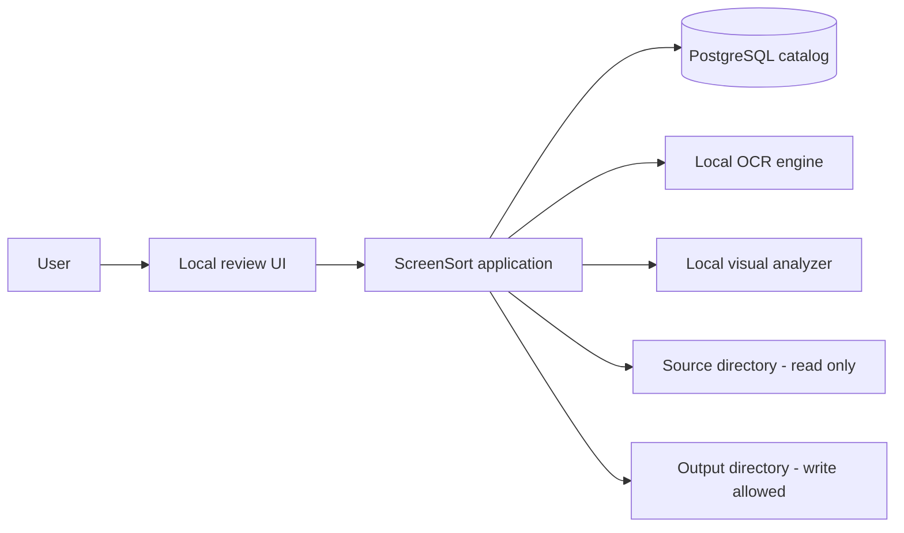
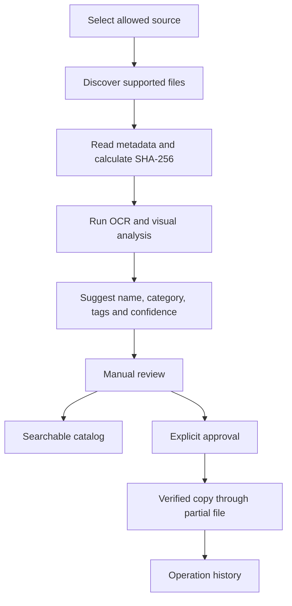
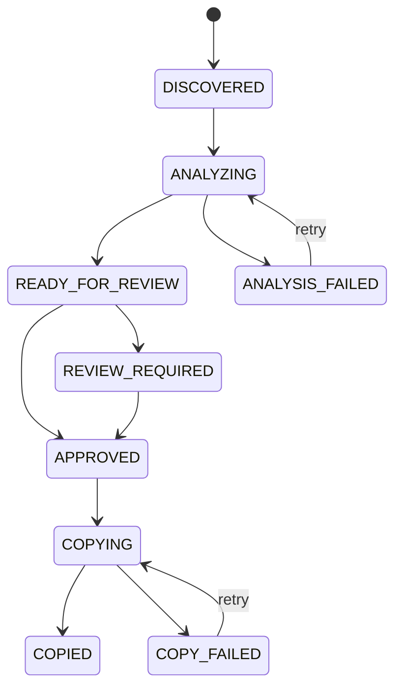

# ScreenSort — Initial Architecture

Status: Draft v0.1

## 1. Architectural goal

Build one deployable modular monolith whose business boundaries remain clear enough to extract an analysis worker later without rewriting the catalog, review or organization logic.

The MVP optimizes for safety, testability and delivery speed rather than distributed-system complexity.

## 2. System context



## 3. Primary processing flow



## 4. Application modules

| Module | Responsibility |
|---|---|
| `catalog` | File identity, metadata, checksum, duplicates and lifecycle |
| `scanning` | Allowed-root validation and discovery of supported files |
| `analysis` | OCR, visual analysis and aggregation of analyzer results |
| `classification` | Category, tag, name and confidence suggestions |
| `review` | Manual corrections and approval state |
| `search` | Queries over names, OCR text, categories and tags |
| `organization` | Copy planning, execution, verification and recovery |
| `web` | Local UI controllers, view models and HTTP boundary |
| `shared` | Small cross-cutting primitives with no business ownership |

This is one Maven application at the start. Package boundaries are preferred over premature Maven modules.

## 5. Dependency direction

```text
web -> application use cases -> domain
                              -> infrastructure ports

infrastructure adapters -> domain/application ports
```

Rules:

- Web controllers call use cases, not repositories.
- Domain objects do not depend on Spring MVC, OCR libraries or file-system implementations.
- OCR and visual analysis are replaceable adapters.
- Classification does not copy or move files.
- Only the organization module may create output files.
- Persistence entities are not returned directly to the UI.

## 6. Analysis pipeline

Each analyzer produces a partial result:

```text
MetadataAnalyzer
    -> dimensions, timestamps, extension

OcrAnalyzer
    -> extracted text, language, OCR confidence

VisualAnalyzer
    -> labels, optional description, visual confidence

AnalysisAggregator
    -> normalized analysis result

SuggestionService
    -> category, proposed name, tags, total confidence, explanation
```

An analyzer failure is recorded independently. For example, a screenshot with failed visual analysis may still be searchable through OCR.

## 7. File lifecycle



Review status and copy-operation status may become separate state machines when implementation begins. They are shown together here only to communicate the product flow.

## 8. Safe-copy protocol

```text
PLANNED
  -> SOURCE_VERIFIED
  -> SPACE_VERIFIED
  -> TARGET_PARTIAL_CREATED
  -> TARGET_HASH_VERIFIED
  -> TARGET_FINALIZED
  -> COMPLETED
```

On failure, the operation becomes `FAILED` or `RECOVERY_REQUIRED`. The original source remains untouched.

## 9. Initial data model

| Aggregate or record | Purpose |
|---|---|
| `AllowedRoot` | Canonical source path and access policy |
| `FileRecord` | Source identity, metadata, checksum and catalog state |
| `AnalysisJob` | Execution state, attempts and errors |
| `AnalysisResult` | OCR text, visual labels, proposed values and analyzer versions |
| `ReviewDecision` | User-corrected name, category and approval information |
| `CopyOperation` | Source, target, expected checksum and recovery state |
| `OperationAttempt` | Audit trail of individual attempts and errors |

The exact relational schema will be defined immediately before the first Flyway migration.

## 10. Filesystem boundary

The application maintains two distinct roots:

```text
source root: read-only
output root: controlled write access
```

Required checks:

- resolve canonical paths;
- reject drive roots, the entire user home and system locations;
- reject traversal outside the allowed root;
- do not follow symbolic links outside the root;
- verify that a file is stable before analysis;
- re-read source metadata and checksum before copying;
- never use overwrite semantics for user files.

## 11. UI boundary

The review UI is local and backend-driven. Its first important screen is the review catalog, not a dashboard.

Each item shows:

- thumbnail;
- original name;
- editable suggested name;
- editable category;
- OCR excerpt;
- visual tags;
- confidence and explanation;
- processing or copy status;
- selection control.

A normal browser page cannot be trusted to provide unrestricted local filesystem paths. The technical cataloging slice may initially use a configured demo directory. A thin native folder picker is introduced before the first user-facing release.

## 12. Deployment profiles

| Profile | Purpose |
|---|---|
| `local` | Application from IDE with PostgreSQL in Docker Compose |
| `test` | Deterministic integration tests with temporary directories and Testcontainers |
| `demo` | Synthetic screenshot set, visible diagnostics and safe fixed roots |

The desktop launcher and distributed worker profiles are future decisions.

## 13. Planned evolution

Only after the complete MVP works locally:

1. automatic directory watching plus periodic reconciliation;
2. more capable local visual models;
3. PDF and document extraction;
4. native desktop packaging;
5. separate analysis worker;
6. Kafka, outbox, retry and dead-letter handling.

