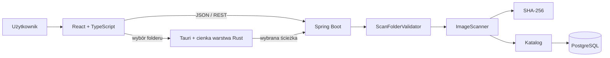
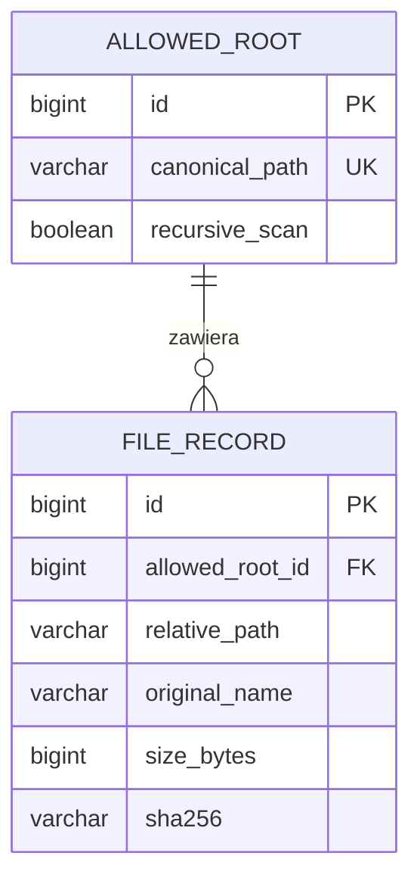

# ScreenSort — decyzje techniczne wyjaśnione po polsku

Status: żywy dokument edukacyjny  
Ostatnia aktualizacja: 2026-10-07

Ten dokument odpowiada nie tylko na pytanie **co** znajduje się w projekcie,
ale przede wszystkim **dlaczego** podjęliśmy daną decyzję. Powinien być
aktualizowany, gdy zmieniamy ważny element technologii, architektury albo modelu
danych.

## Jak czytać statusy

- **Działa** — kod istnieje i został uruchomiony lub przetestowany.
- **Następny etap** — decyzja jest podjęta, ale kod jeszcze nie istnieje.
- **Później** — element należy do MVP, lecz nie jest obecnym zadaniem.

## 1. Stos technologiczny

| Element | Technologia | Status | Dlaczego |
|---|---|---|---|
| Backend | Java 25 + Spring Boot 4 | Działa | Java daje silne typowanie, a Spring składa komponenty i udostępnia REST API. |
| Budowanie backendu | Maven Wrapper | Działa | Każdy komputer używa kontrolowanej wersji Mavena bez ręcznej instalacji projektu. |
| Frontend | React 19 + TypeScript + Vite 8 | Działa | Komponentowy interfejs, typowanie danych z API i szybki development server. |
| Baza | PostgreSQL | Działa | Przechowuje opisy obrazów i hashe, nie bajty obrazów. Relacje, constraints, indeksy i transakcje pasują do katalogu plików. |
| Uruchamianie bazy | Docker Compose | Działa | Lokalny PostgreSQL ma powtarzalną konfigurację i nie wymaga ręcznej instalacji serwera. |
| Wersjonowanie bazy | Flyway | Działa | Struktura bazy jest odtwarzalna z uporządkowanych migracji SQL. |
| ORM i repozytoria | JPA/Hibernate + Spring Data JPA | Działa | Mapowanie wierszy PostgreSQL na obiekty Java i mniej ręcznego kodu SQL dla prostych operacji. |
| Aplikacja desktopowa | Tauri 2 + Rust | Działa w development | Natywne okno i folder picker przy zachowaniu interfejsu React. Installer i uruchamianie Javy przez powłokę są późniejszym etapem. |
| OCR | Jeszcze nie wybrano | Później | Najpierw kończymy bezpieczny, trwały katalog. |

ScreenSort pozostaje **modularnym monolitem**: jedna aplikacja Spring Boot i jedna
baza. Nie wprowadzamy mikroserwisów, dopóki działające MVP nie pokaże realnej
potrzeby niezależnego skalowania którejś części.

## 2. Docelowy przepływ aplikacji



Tauri nie zastępuje Spring Boota. Rust odpowiada docelowo za małą warstwę
natywną, przede wszystkim picker folderu. Walidacja ścieżki, skanowanie,
katalogowanie, OCR i reguły biznesowe pozostają w Javie.

## 3. SHA-256 — po co i jak sprawdzamy poprawność

SHA-256 tworzy identyfikator na podstawie **zawartości** pliku, a nie jego nazwy
lub ścieżki.

```text
ten sam zestaw bajtów  -> ten sam SHA-256
zmiana choćby jednego bajtu -> inny SHA-256
```

W Javie nie implementujemy algorytmu kryptograficznego samodzielnie. Używamy
`MessageDigest.getInstance("SHA-256")` z platformy Java. Nasz kod odpowiada za
odczyt pliku, przekazanie bajtów i zapis wyniku jako tekst szesnastkowy.

256 bitów daje 64 cyfry szesnastkowe, ponieważ jedna cyfra szesnastkowa opisuje
4 bity:

```text
256 / 4 = 64
```

Poprawność można sprawdzić na dwa sposoby:

1. Porównać z niezależnym narzędziem systemowym:

   ```powershell
   Get-FileHash -Algorithm SHA256 .\demo-images\xzzz1.png
   ```

2. Użyć oficjalnego, znanego wektora testowego:

   ```text
   dane: "abc"
   SHA-256:
   ba7816bf8f01cfea414140de5dae2223b00361a396177a9cb410ff61f20015ad
   ```

Samo sprawdzenie długości 64 znaków wykrywa część błędów, ale nie dowodzi, że
wynik jest poprawny. Test z konkretną oczekiwaną wartością jest silniejszy.

### Odczyt porcjami zamiast całego pliku w RAM

`FileHasher` czyta plik przez `InputStream` do jednego bufora o wielkości
64 KiB (65 536 bajtów). Każdy odczyt ponownie wykorzystuje tę samą tablicę.
`MessageDigest.update(buffer, 0, bytesRead)` otrzymuje tylko faktycznie odczytane
bajty; ostatnia porcja może być krótsza niż bufor. Po końcu pliku `digest()`
zwraca jeden SHA-256 całej zawartości, a nie osobne hashe porcji.

64 KiB to praktyczny początkowy kompromis między wielkością bufora a liczbą
odczytów, nie udowodniony najszybszy rozmiar. Wcześniejsze `readAllBytes`
tworzyło tablicę zależną od rozmiaru pliku. Teraz tablica ma stałą wielkość;
dwa aktywne zadania hashowania potrzebują łącznie 128 KiB na te bufory.
Nie jest to limit pamięci całej aplikacji: dekodowanie obrazów przez `ImageIO`,
wyniki skanu i pozostałe komponenty nadal zajmują własną pamięć.

Bufor i `MessageDigest` są lokalne dla pojedynczego wywołania, więc workery nie
współdzielą ich zmiennego stanu. `try-with-resources` zamyka plik także przy
błędzie. Nadal czytamy wszystkie bajty: zmiana ogranicza pamięć, ale nie pomija
niezmienionych plików ani nie gwarantuje dużego przyspieszenia skanu.

Testy porównują hash obrazu demo i znane wyniki dla `abc` oraz pustego pliku,
a także odczyt porcjami z odczytem jednorazowym dla rozmiarów tuż przed, na
i za granicą bufora oraz dla kilku porcji z niepełnym końcem. Pliki testowe
powstają wyłącznie w katalogach tymczasowych; źródłowe obrazy są tylko czytane.

## 4. Flyway — migracje bazy

Migracja to wersjonowana operacja zmieniająca **strukturę lub kontrolowane dane
bazy**. Nie tworzymy migracji dla każdego commita Git.

Tworzymy nową migrację, gdy baza ma wykonać nową zmianę, na przykład:

```text
V1__initialize_database.sql
V2__create_allowed_root.sql
V3__create_file_record.sql
V4__add_mime_type_to_file_record.sql
```

Pomiędzy `V3` i `V4` może istnieć jeden commit albo kilkadziesiąt commitów bez
żadnej migracji. Numer opisuje kolejność zmian bazy, nie numer wersji całej
aplikacji.

### Migracja a Git

| Git | Flyway |
|---|---|
| Wersjonuje pliki kodu | Wersjonuje zmiany schematu i kontrolowanych danych |
| Commit może być łatwo odczytany w starej wersji | Migracja zmienia działającą bazę z danymi |
| Historia znajduje się w `.git` | Historia znajduje się w `flyway_schema_history` |
| Commit ma identyfikator | Zastosowana migracja ma wersję i checksum |

Flyway zapisuje checksum zastosowanego pliku. Edycja starej, wykonanej migracji
powoduje `CHECKSUM_MISMATCH`. Dlatego po zastosowaniu `V3` zwykle jej nie
przepisujemy — dodajemy `V4`.

### Czy można cofnąć bazę z V6 do V3?

Nie działa to jak zwykły `git checkout`. Migracja opisuje zmianę struktury, a
baza zawiera aktualne dane użytkownika. Cofnięcie może wymagać:

- nowej migracji kompensującej, która bezpiecznie odwraca zmianę;
- przywrócenia backupu;
- osobnego planu migracji danych.

Powrót do struktury z V3 nie oznacza automatycznie odzyskania danych, które
istniały w chwili wykonywania V3. Flyway przechowuje historię migracji, a nie
kopię całej bazy z każdego etapu. Backup i migracja to dwa różne mechanizmy.

## 5. PostgreSQL `IDENTITY` a MySQL `AUTO_INCREMENT`

MySQL często używa:

```sql
id BIGINT AUTO_INCREMENT PRIMARY KEY
```

PostgreSQL używa standardowego SQL:

```sql
id BIGINT GENERATED BY DEFAULT AS IDENTITY PRIMARY KEY
```

Cel jest podobny: jeżeli aplikacja nie poda ID, baza generuje kolejną wartość.

```text
pierwszy rekord -> 1
drugi rekord    -> 2
trzeci rekord   -> 3
```

`BY DEFAULT` pozwala wyjątkowo podać własne ID. `GENERATED ALWAYS` jest bardziej
restrykcyjne i normalnie odrzuca ręcznie podaną wartość. Samo `IDENTITY` oznacza
generowanie i `NOT NULL`; dopiero `PRIMARY KEY` wymusza również unikalność.

## 6. `INTEGER`, `BIGINT`, Java `int` i `long`

| PostgreSQL | Java | Rozmiar | Przybliżony dodatni zakres |
|---|---|---:|---:|
| `INTEGER` | `int` / `Integer` | 4 bajty, 32 bity | do 2,1 miliarda |
| `BIGINT` | `long` / `Long` | 8 bajtów, 64 bity | do około 9,2 tryliona |

`BIGINT` nie ma tylko dwa razy większego zakresu. Ma dwa razy więcej bitów, więc
liczba możliwych kombinacji rośnie wykładniczo.

W ScreenSort `INTEGER` prawdopodobnie wystarczyłby dla liczby obrazów. Używamy
`BIGINT`, ponieważ:

- `allowed_root.id` już ma ten typ;
- foreign key `file_record.allowed_root_id` powinien mieć zgodny typ;
- Java naturalnie mapuje go na `Long`;
- `Files.size(path)` zwraca `long`, dlatego `size_bytes` naturalnie mapuje się na
  `BIGINT`.

To nie znaczy, że `BIGINT` jest zawsze lepszy. Zajmuje więcej miejsca w tabeli i
indeksach. Jest świadomym kompromisem między zapasem a kosztem.

## 7. Relacja `AllowedRoot` do `FileRecord`

`AllowedRoot` oznacza folder, który przeszedł walidację bezpieczeństwa i może być
źródłem skanowania.



Przykładowe dane:

### `allowed_root`

| id | canonical_path |
|---:|---|
| 1 | `C:\Pictures\Screenshots` |
| 2 | `D:\Work\Images` |

### planowana tabela `file_record`

| id | allowed_root_id | relative_path |
|---:|---:|---|
| 10 | 1 | `spring-error.png` |
| 11 | 1 | `invoice.png` |
| 12 | 2 | `code\controller.png` |

`file_record.id = 10` identyfikuje konkretny wiersz obrazu. Jego
`allowed_root_id = 1` mówi, że plik należy do folderu opisanego przez
`allowed_root.id = 1`.

Pełną ścieżkę można logicznie złożyć:

```text
C:\Pictures\Screenshots
+
spring-error.png
=
C:\Pictures\Screenshots\spring-error.png
```

ID obu tabel nie muszą być takie same. Pełnią inne role:

```text
allowed_root.id = 1      -> identyfikator folderu
file_record.id = 10      -> identyfikator obrazu
file_record.allowed_root_id = 1 -> wskazanie folderu obrazu
```

## 8. Constraint, `FOREIGN KEY` i `REFERENCES`

**Constraint** to reguła pilnowana przez samą bazę danych. Kod Java może mieć
błąd, ale PostgreSQL nadal odrzuci dane łamiące regułę.

```sql
CONSTRAINT fk_file_record_allowed_root
    FOREIGN KEY (allowed_root_id)
    REFERENCES allowed_root(id)
```

Znaczenie elementów:

- `CONSTRAINT` — definiujemy nazwaną regułę;
- `fk_file_record_allowed_root` — czytelna nazwa reguły, gdzie `fk` oznacza
  foreign key;
- `FOREIGN KEY (allowed_root_id)` — kolumna w tabeli `file_record`, którą
  kontrolujemy;
- `REFERENCES allowed_root(id)` — wartość musi istnieć w kolumnie `id` tabeli
  `allowed_root`.

Próba zapisu `allowed_root_id = 999`, gdy folder 999 nie istnieje, zakończy się
błędem. Zapobiega to osieroconym rekordom obrazów.

Frontendowa analogia typu:

```ts
type FileRecord = {
  allowedRootId: number
}
```

nie daje tej samej gwarancji w runtime. Foreign key sprawdza realne dane podczas
każdego zapisu do bazy.

Typowe prefiksy nazw:

| Prefix | Znaczenie |
|---|---|
| `pk_` | primary key |
| `fk_` | foreign key |
| `uk_` | unique key |
| `ck_` | check constraint |
| `ix_` | index |

Nazwy nie zmieniają zachowania SQL, ale pomagają zrozumieć komunikaty błędów i
późniejsze migracje.

## 9. `UNIQUE`, `CHECK` i indeks

### `UNIQUE`

Planowana reguła:

```sql
UNIQUE (allowed_root_id, relative_path)
```

oznacza, że ta sama lokalizacja nie może zostać zapisana dwa razy w tym samym
folderze źródłowym.

```text
root 1 + image.png -> dozwolone
root 2 + image.png -> dozwolone, inny folder
root 1 + image.png -> drugi raz niedozwolone
```

PostgreSQL automatycznie tworzy unikalny indeks dla `PRIMARY KEY` i `UNIQUE`.
Nie tworzymy dla nich drugiego ręcznego indeksu.

### `CHECK`

```sql
CHECK (size_bytes >= 0)
CHECK (LENGTH(sha256) = 64)
```

to proste warunki poprawności pojedynczego wiersza. Baza odrzuci ujemny rozmiar
albo hash o nieprawidłowej długości.

### Indeks SHA-256

```sql
CREATE INDEX ix_file_record_sha256 ON file_record(sha256);
```

Indeks jest dodatkową strukturą przyspieszającą wyszukiwanie. Bez niego baza może
sprawdzać każdy wiersz. Z nim szybciej wykonuje zapytanie typu:

```sql
SELECT * FROM file_record WHERE sha256 = ?;
```

Indeks nie jest darmowy: zajmuje miejsce i musi być aktualizowany przy zapisie.
Tworzymy go tutaj, ponieważ wyszukiwanie po SHA-256 jest realną funkcją do
wykrywania duplikatów.

SHA-256 nie otrzymuje `UNIQUE`. Dwa różne pliki mogą mieć identyczną zawartość:

```text
photo.png      -> hash abc
photo-copy.png -> hash abc
```

Chcemy zachować oba rekordy lokalizacji i jednocześnie oznaczyć je jako duplikaty
treści.

## 10. Idempotentny ponowny skan

Idempotencja oznacza, że powtórzenie tej samej operacji nie tworzy
niekontrolowanych dodatkowych efektów.

```text
pierwszy skan -> dwa rekordy
drugi skan    -> nadal dwa rekordy
```

Planowana logika:

1. Znajdź lub zapisz `AllowedRoot` po jego `canonical_path`.
2. Dla każdego zaakceptowanego obrazu oblicz `relative_path`.
3. Wyszukaj rekord po parze `allowed_root_id + relative_path`.
4. Jeżeli nie istnieje — wykonaj insert.
5. Jeżeli istnieje — zaktualizuj metadane oraz `last_seen_at`.
6. Wyszukiwanie po SHA-256 pokaże inne lokalizacje o identycznej zawartości.

Constraint `UNIQUE` jest ostatnią ochroną bazy, a nie całym algorytmem. Kod Java
powinien znaleźć i zaktualizować rekord; ślepy drugi insert zakończy się błędem
unikalności.

## 11. MIME type a rozszerzenie

Rozszerzenie pochodzi z nazwy:

```text
photo.png -> extension: png
```

MIME type opisuje format danych:

```text
PNG  -> image/png
JPEG -> image/jpeg
```

Plik JPEG może zostać nazwany `fake.png`. Wtedy rozszerzenie i rzeczywisty format
nie są tym samym. ScreenSort potrafi już odrzucić niedekodowalny obraz, ale nie
zapisuje jeszcze wykrytego formatu. MIME type dodamy po poprawnym rozpoznawaniu
formatu, zamiast zgadywać go wyłącznie z nazwy.

## 12. Obecny katalog i najbliższy etap

Migracja `V3__create_file_record.sql` istnieje i została poprawnie zastosowana
na lokalnym PostgreSQL 18.6. Utworzyła tabelę katalogu na podstawie pól, które
obecnie posiada `AcceptedImage`:

- powiązanie z `AllowedRoot`;
- relative path i original name;
- extension;
- size bytes;
- last modified at;
- SHA-256;
- first discovered at i last seen at.

Encje JPA, repozytoria, zapis/odczyt i testy integracyjne z tymczasowym
PostgreSQL-em już działają. React odczytuje zapisany katalog:

```text
scan 1 -> 2 rekordy
scan 2 -> nadal 2 rekordy
restart -> rekordy nadal istnieją
```

Stronicowany katalog, miniatury po ID rekordu, galeria i większy podgląd już działają.
Nie oznacza to jeszcze OCR, automatycznej zmiany nazw ani kopiowania.

## 13. Skan przyrostowy i podsumowanie

`KnownFilesReader` pobiera cztery pola z bazy dla wybranego folderu:
ścieżkę względną, rozmiar, datę modyfikacji i SHA-256. Nie pobiera zdjęć.
Mapa `relativePath -> KnownFile` pozwala workerowi szybko znaleźć poprzedni
opis bez osobnego zapytania SQL dla każdego odczytywanego wpisu folderu.

Po kontrolach linku, zwykłego pliku, rozszerzenia i rozmiaru skaner porównuje
aktualny rozmiar i datę modyfikacji z poprzednimi. Przy zgodności korzysta
z zapisanego hasha. W przeciwnym razie odczytuje obraz i liczy hash od nowa.
Obcinamy datę do mikrosekund zarówno przy zapisie, jak i porównaniu, ponieważ
PostgreSQL nie przechowuje pełnej nanosekundowej precyzji `Instant`.

| `ImageScanType` | Znaczenie | Odczyt obrazu i nowy hash |
|---|---|---|
| `NEW` | Brak poprzedniego opisu pod tą ścieżką | Tak |
| `RESCANNED` | Znany obraz, ale inne metadane | Tak |
| `UNCHANGED` | Zgodne metadane, wykorzystany poprzedni opis | Nie |

Te etykiety dotyczą wyłącznie zaakceptowanych obrazów. Plik, który nie przejdzie
kontroli, trafia tylko do odrzuconych. `RESCANNED` nie oznacza koniecznie innych
bajtów: sama zmiana daty już wymaga ponownego sprawdzenia, nawet jeśli hash
po przeliczeniu pozostanie taki sam.

`ImageScanType` jest prywatnym enumem w skanerze, ponieważ opisuje jego pracę,
a nie trwały stan rekordu bazy. Worker oddaje etykietę w `FileOutcome.Accepted`.
Główny wątek skanu zwiększa liczniki po odebraniu wyników. Nie potrzeba
współdzielonych liczników ani dodatkowej synchronizacji między workerami.

`ScanSummary` to record z czterema licznikami: `newImages`, `rescannedImages`,
`unchangedImages`, `rejectedFiles`. `ScanResult` sprawdza zgodność tych liczb
z rozmiarami list wyników. API przekazuje ten niemutowalny record jako `summary`
wewnątrz `ScanResultDto`. Nie jest encją JPA i nie ujawnia obiektów Hibernate.
Osobny DTO z identycznymi czterema liczbami nie wniósłby teraz dodatkowych danych.

React otrzymuje gotowe liczniki i wyświetla je komponentem `ScanSummary`.
Nie wylicza ich z całego katalogu ani nie przechowuje czterech kopii w osobnych
stanach. Ta funkcja nie wymaga nowej migracji: nie zmieniamy struktury bazy.

Ważne ograniczenie: można zmienić zawartość i zachować rozmiar oraz datę.
`UNCHANGED` jest decyzją optymalizacyjną na podstawie metadanych, nie dowodem
tożsamości bajtów. Pełne sprawdzenie i przyszłe kopiowanie muszą móc ponownie
policzyć hash. Testy sprawdzają liczniki, brak wywołania hashera przy zgodnych
metadanych, ponowne wywołanie przy innej dacie lub rozmiarze i przepływ przez API.

## 14. Stronicowanie katalogu: baza → API → React

Zamiast pobierać wszystkie opisy i wycinać z nich 50 w Javie albo React,
przekazujemy do repozytorium `PageRequest`. Ograniczenie działa już w zapytaniu
PostgreSQL: mniej rekordów trafia do Javy, JSON-a i widoku. Nie jest to nowy
algorytm skanowania ani pobieranie samych zdjęć — stronicujemy ich zapisane opisy.

```text
Poprzednia/Następna → numer żądanej strony w React
  → GET /api/catalog/page?folderPath=...&pageNumber=...&pageSize=50
  → kontroler: sprawdź numer i rozmiar
  → reader: zweryfikuj folder i znajdź go w bazie
  → repozytorium: pobierz stronę, uporządkuj po relativePath
  → CatalogPageDto → JSON → katalog w React
```

| Decyzja | Dlaczego | Koszt lub alternatywa |
|---|---|---|
| `Page<FileRecordEntity>` | Potrzebujemy plików, liczby wszystkich i `hasNext`. | Spring Data może wykonać dodatkowe zapytanie zliczające. `Slice` wystarczyłoby do nawigacji bez dokładnego totalu. |
| Kolejność `relativePath ASC` | Strony mają określoną kolejność; ścieżka jest unikalna w ramach folderu. | Przy równoczesnych zmianach katalogu strony offsetowe mogą się przesuwać; nie jest to zamrożona migawka całego katalogu. |
| Numer od 0 w API | Tak działa `PageRequest`; UI dodaje 1 tylko przy wyświetlaniu. | „Strona 1” w UI to `pageNumber=0`, a nie 1. |
| Rozmiar od 1 do 50 | Kontroler ogranicza liczbę rekordów pojedynczej odpowiedzi. | 50 to początkowy kompromis, nie wynik pomiaru dowodzący idealnego rozmiaru. |
| `CatalogPageDto` zamiast encji | Oddzielamy kontrakt UI od Hibernate i relacji JPA. | Trzeba jawnie zamienić pobrane encje na `CatalogFileDto`. |
| Jedna odpowiedź `catalogPage` w stanie | Pliki, total i `hasNext` pochodzą z tej samej odpowiedzi; nie przechowujemy drugiej kopii listy. | Numer żądanej strony jest osobny, bo wyzwala pobranie następnej odpowiedzi. |

`URLSearchParams` zapisuje parametry w query string i koduje ścieżkę folderu.
`fetchCatalog` odrzuca odpowiedź HTTP inną niż poprawna, potem odczytuje JSON.
Typ TypeScript opisuje oczekiwany kształt; samo `as CatalogPage` nie sprawdza
kształtu odpowiedzi w runtime.

Efekt Reacta reaguje na folder katalogu, numer strony i sygnał odświeżenia.
Cleanup ustawia `ignore`, aby późna odpowiedź poprzedniego żądania nie nadpisała
nowszego widoku. Nie przerywa samego żądania. Stan ładowania i błąd resetujemy
w handlerach, które uruchamiają pobranie; na starcie ładowanie jest już włączone.
To odpowiada wzorcowi opisanemu w
[dokumentacji Reacta o pobieraniu danych w efektach](https://react.dev/learn/synchronizing-with-effects#fetching-data).

Po udanym skanie wracamy do strony 0 i odświeżamy katalog dla zeskanowanego
folderu. W aktualnej galerii sam wybór folderu otwiera też jego zapisany katalog,
bez skanowania. `screensort.lastFolder` jest istniejącym kluczem localStorage,
nie nową tabelą ani nową funkcją paginacji.

Ta zmiana nie ogranicza `POST /api/scan` ani mapy znanych plików. Skan nadal
obejmuje cały dozwolony folder, a listy wyników skanu nadal trafiają w całości
do starego klienta; obecny React używa migawek ScanJob i ograniczonej próbki
odrzuceń opisanej niżej. Stronicowanie ogranicza tylko widok zapisanych rekordów. Nie potrzeba migracji,
ponieważ nie zmieniamy tabel. Stary endpoint listy pozostaje przejściowo dostępny;
React korzysta już wyłącznie z endpointu strony.

## 15. Galeria i podglądy na żądanie

Oddzielamy pobranie strony opisów od pobrania obrazów. Kafelek potrzebuje
miniatury, a większy podgląd pobieramy tylko dla wybranego ID. Nie wysyłamy
oryginałów do wszystkich kafelków. Zamiast dopisywać wszystko do `App.tsx`,
komponenty i typy galerii są w `frontend/src/catalog`.

Backendowa funkcja jest w `catalog/preview`: krótki odczyt JPA kończy się przed
pracą z plikiem. ID rekordu nie zastępuje walidacji źródła. `ImageReader`
kontroluje format i wymiary, podgląd jest ponownie kodowany do PNG w pamięci.
Nie zmieniamy skanera ani schematu bazy. Dwa dekodery i ograniczony cache
chronią przed nieograniczoną równoległością i wzrostem pamięci przechowywanych
podglądów. To nie oznacza, że cała JVM zużywa tylko 16 MiB.

Po trafieniu w cache nadal sprawdzamy folder i plik. To cache wygody UI,
nie dowód identyczności zawartości ani uprawnienie do późniejszego kopiowania.
Backend domyślnie nasłuchuje tylko na loopback, nie w sieci LAN.
Pełne uzasadnienie, wartości limitów, alternatywy i ograniczenia:
[`galeria-i-podglady.md`](galeria-i-podglady.md).

## 16. Okrągłe miniatury i centralny podgląd z gałęziami

Właściciel wybrał kierunek retro PC: kółka zamiast kart i połączone gałęzie
szczegółów. Pierwsza wersja rozwijała je pod rzędem miniatur; kolejna prośba
przeniosła podgląd na środek ekranu, nad przyciemnione i lekko rozmyte tło.
To zmiana prezentacji danych, nie nowa architektura backendu. `ImageDetailsDialog`
obsługuje okno, a `ImageDetailsTree` zachowuje wszystkie pola `CatalogFile`.

Używamy natywnego `<dialog>` i `showModal()`, bo przeglądarka zapewnia najwyższą
warstwę widoku oraz nieaktywne tło. Alternatywy — nowa biblioteka modali albo
własny portal z ręczną blokadą całej strony — nie są potrzebne w tym zakresie.
Efekt Reacta otwiera okno i ma cleanup zamykający je, także w StrictMode.
X, Escape i kliknięcie tła czyszczą wybór; fokus wraca do miniatury.
Zawijamy końce nawigacji Tab, by nie przechodzić do paska przeglądarki.
Nagłówek pozostaje widoczny, a długa treść przewija się wewnątrz.

Nie stosujemy biblioteki grafów: użytkownik nie edytuje połączeń ani nie
przesuwa węzłów. CSS grid układa treść; niewielkie SVG rysuje dekoracyjne
połączenia w odstępach. Jeden hook mierzy podgląd i gałęzie, a czysta funkcja
oblicza linie. Usunięto pomiar kolumn i pozycjonowanie pod rzędem, których modal
już nie potrzebuje. Dzięki temu testy obliczeń układu nie potrzebują
przeglądarki ani bazy. Obserwatory mają cleanup, a pomiar nie wywołuje API.

Natywne `<details>/<summary>` zapewniają rozwijanie gałęzi i klawiaturę bez
dodatkowego stanu dla każdego pola. Miniatura jest okrągłym kadrem, natomiast
większy podgląd zachowuje cały obraz. `selectedId` pozostaje jedynym stanem
wyboru. Większy obraz pobieramy tylko po wyborze. Rozmycie tła to stałe 3 px,
bez animacji kosztownego filtra; przy braku obsługi zostaje przyciemnienie.
Ta zmiana nie przyspiesza samego skanu ani nie zmienia pracy JVM.

VT323 jest lokalnym zasobem na licencji OFL, a licencja trafia do produkcyjnego
pakietu przez `frontend/public`. Nie pobieramy fontów z internetu przy starcie.
Konkurencyjne rozwiązania — font systemowy lub CDN — odpowiednio nie oddawały
wybranego stylu albo wymagały zewnętrznego połączenia. Nie dodano zależności
do renderowania drzewa ani testów: korzystamy z istniejącego Reacta,
TypeScript i test runnera Node. Szczegóły: [`galeria-i-podglady.md`](galeria-i-podglady.md).

## 17. Zadania skanu i obserwowanie postępu

Dodaliśmy obudowę istniejącego workflow, nie drugi algorytm skanowania.
`ScanStatus` jest enumem etapów, `ScanJob` niemodyfikowalnym opisem konkretnego
uruchomienia, a `ScanJobManager` uruchamia pracę i podmienia opisy postępu.
UUID zadania nie jest ID pliku ani folderu z PostgreSQL.

| Decyzja | Dlaczego | Ograniczenie lub alternatywa |
|---|---|---|
| Osobny wykonawca całego workflow | Koordynator czeka na workery plików, więc nie powinien zabierać im własnej puli. | Jeden wątek zadania nie zwiększa liczby workerów ani szybkości dekodowania. |
| Jedno aktywne skanowanie | Chroni przed równoczesnymi zapisami i powielaniem ciężkiej pracy po kilku kliknięciach. | Kolejne żądanie dostaje 409; nie ma kolejki folderów. |
| Record jako migawka | UI odczytuje spójny status i liczniki, a stara odpowiedź nie zmienia się po wysłaniu. | Przy zmianie powstaje nowy record; mapa wymaga synchronizacji. |
| Krótkie metody `synchronized` | Sprawdzenie i rezerwacja są atomowe; GET nie czyta modyfikowanej mapy. | Nie blokujemy monitorem całego workflow ani pracy z obrazami. |
| Do 20 opisów w pamięci | Nie przechowujemy nieograniczonej historii ani drugiej kopii list zdjęć. | Restart usuwa opisy; trwałe zadania i wznawianie wymagają osobnego projektu. |
| Liczniki po odebraniu wyników | To rzeczywisty postęp, nie liczba dopiero zleconych zadań. | Brak procentu, bo nie wykonujemy dodatkowego liczenia wpisów folderu. |
| Nowe API obok starego | React używa teraz zadań, stary prototyp nadal działa synchronicznie. | Oba wejścia korzystają z tej samej blokady jednego skanu. |
| Sekwencyjny polling około raz na sekundę | Prosty obserwowalny postęp, bez nakładających się GET-ów i infrastruktury SSE/WebSocket. | Krótki skan może zakończyć się między odczytami; status nie pokazuje każdego pośredniego licznika. |
| Do 100 przykładów odrzuceń na zadanie | Zachowujemy wyjaśnienia w UI bez przechowywania pełnego ScanResult dla 20 zadań. | UI jawnie pokazuje skrócenie; licznik obejmuje wszystkie odrzucone. |

Nowe API: `POST /api/scan/jobs` przyjmuje pracę i zwraca 202 z ID;
`GET /api/scan/jobs/{id}` odczytuje stan. Zakończenie wymaga udanego zapisu
w PostgreSQL. Odrzucony plik sam w sobie nie powoduje `FAILED` całego zadania.
Pełna mapa kodu, wyjaśnienie callbacków, wykonawcy i ograniczeń:
[`zadania-skanowania.md`](zadania-skanowania.md).

Omówienie rzeczywistego kodu z rozróżnieniem poprzednich i nowych zmian:
[`scanjob-krok-po-kroku.md`](scanjob-krok-po-kroku.md).
