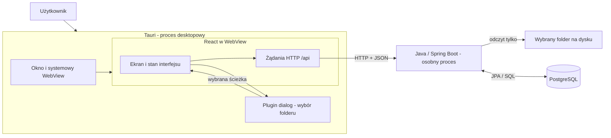
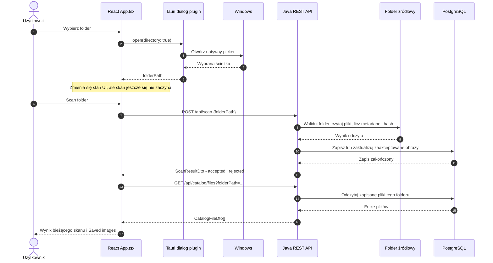
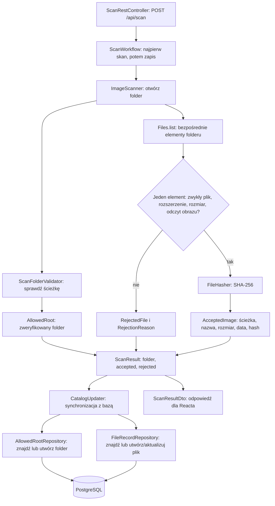
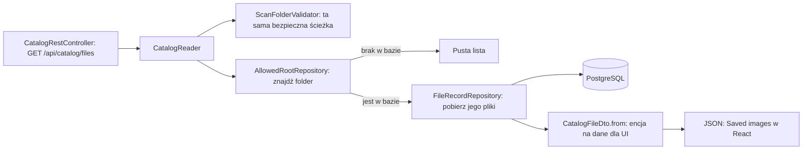

# ScreenSort - mapa architektury (stan obecny)

Ten dokument opisuje **kod, który istnieje dziś**. Diagramy pokazują połączenia między Tauri, Reactem, Javą i PostgreSQL-em. Nie są listą klas, które trzeba teraz dopisać.

Wersja do czytania na telefonie: [PDF z mapą architektury](../output/pdf/screensort-architektura.pdf). Osobny [plan kolejnego etapu i wydajności](nastepny-etap-i-wydajnosc.md) również ma [wersję PDF](../output/pdf/screensort-plan-wydajnosc.pdf).

PDF-y są wcześniejszą migawką. Aktualny układ pakietów po uporządkowaniu
`scanning` opisuje [mapa plików projektu](struktura-projektu.md).

## 1. Gdzie działa każda część

- **Tauri:** uruchamia okno i udostępnia natywny picker folderu. Obecnie nie uruchamia automatycznie Javy ani bazy. Kod startowy: [`frontend/src-tauri/src/lib.rs`](../frontend/src-tauri/src/lib.rs), konfiguracja: [`frontend/src-tauri/tauri.conf.json`](../frontend/src-tauri/tauri.conf.json).
- **React:** przechowuje ścieżkę i stan ekranu, wywołuje API, wyświetla wyniki i błędy. Nie czyta sam zawartości zdjęć ani nie rozmawia bezpośrednio z PostgreSQL-em. Kod: [`frontend/src/App.tsx`](../frontend/src/App.tsx).
- **Java:** waliduje ścieżkę, czyta źródłowe pliki, klasyfikuje obrazy, liczy SHA-256 i zapisuje lub odczytuje metadane. `ScreenSortApplication` tylko uruchamia Spring Boot: [`ScreenSortApplication.java`](../src/main/java/pl/pum/screensort/ScreenSortApplication.java).
- **PostgreSQL:** przechowuje opisy plików, nie kopie zdjęć. W rozwoju baza jest uruchamiana przez Docker Compose. Obrazy źródłowe pozostają tylko do odczytu.

W trybie developerskim Tauri wyświetla Vite na `127.0.0.1:5173`, a [konfiguracja Vite](../frontend/vite.config.ts) przekazuje `/api` do Spring Boot na `127.0.0.1:8080`. Sposób uruchamiania wszystkiego przez docelowy instalator jest jeszcze do zaprojektowania.

## 2. Jedno kliknięcie - przepływ przez procesy

`POST` pyta „co jest w folderze **teraz**?”, a `GET` pyta „co **zapamiętaliśmy** w bazie?”. Wybranie folderu w pickerze nie uruchamia jeszcze skanu. React odczytuje katalog także przy wejściu na ekran dla ostatnio użytej ścieżki.

## 3. Wnętrze Javy - skanowanie i zapis

Główne pliki: [`ScanRestController`](../src/main/java/pl/pum/screensort/scanning/api/ScanRestController.java), [`ScanWorkflow`](../src/main/java/pl/pum/screensort/scanning/workflow/ScanWorkflow.java), [`ScanFolderValidator`](../src/main/java/pl/pum/screensort/scanning/folder/ScanFolderValidator.java), [`ImageScanner`](../src/main/java/pl/pum/screensort/scanning/image/ImageScanner.java), [`FileHasher`](../src/main/java/pl/pum/screensort/scanning/hashing/FileHasher.java), [`CatalogUpdater`](../src/main/java/pl/pum/screensort/catalog/writing/CatalogUpdater.java).

Przetwarzanie pojedynczych plików wykonuje pula dwóch workerów. Skaner zleca
maksymalnie cztery zadania w toku na jeden skan, odbiera ukończone wyniki i
zbiera je w `ScanResult`. Powyższy diagram pokazuje etapy, a nie jeden wątek.
`KnownFilesReader` jest jeszcze szkieletem z TODO i nie bierze udziału w tym przepływie.

Skan jest obecnie **nierekurencyjny**: przegląda elementy bezpośrednio w wybranym folderze. Odrzucone pliki trafiają do odpowiedzi bieżącego skanu, ale nie do tabeli `file_record`. Dla zaakceptowanego pliku kluczem lokalizacji jest para `(allowed_root_id, relative_path)`. Ponowny skan tej samej lokalizacji aktualizuje istniejący rekord, m.in. `last_seen_at`. Taki sam hash w innej lokalizacji nie jest jeszcze automatycznie oznaczany jako duplikat.

## 4. Wnętrze Javy - odczyt katalogu

Główne pliki: [`CatalogRestController`](../src/main/java/pl/pum/screensort/catalog/api/CatalogRestController.java), [`CatalogReader`](../src/main/java/pl/pum/screensort/catalog/reading/CatalogReader.java), [`CatalogFileDto`](../src/main/java/pl/pum/screensort/catalog/dto/CatalogFileDto.java). Odczyt katalogu **nie skanuje obrazów ponownie**. Wykorzystuje walidator ścieżki, a następnie czyta dane z PostgreSQL-a.

## 5. Te same zdjęcia, różne obiekty

| Obiekt | Gdzie powstaje | Po co istnieje |
|---|---|---|
| `Path` / `folderPath` | React i wejście API | Wskazuje wybrany folder. To jeszcze nie dowód, że ścieżka jest bezpieczna. |
| `AllowedRoot` | `ScanFolderValidator` | Przenosi zweryfikowaną ścieżkę wewnątrz Javy. |
| `AcceptedImage` / `RejectedFile` | `ImageScanner` | Opisuje decyzję dotyczącą jednego elementu folderu. |
| `ScanResult` | `ImageScanner` | Zbiera wynik jednego skanowania. |
| `AllowedRootEntity` / `FileRecordEntity` | `CatalogUpdater` i JPA | Odpowiadają wierszom tabel bazy danych. |
| `ScanResultDto` | `ScanRestController` | Wynik bieżącego skanu wysyłany do Reacta. |
| `CatalogFileDto` | `CatalogReader` | Zapisany rekord katalogu wysyłany do Reacta. |

`api` to granica HTTP, `dto` to kształt danych tej granicy, `database` to kod dostępu do bazy, a nie sama baza. Strukturę tabel definiują migracje Flyway w [`src/main/resources/db/migration`](../src/main/resources/db/migration). Starszy ekran Thymeleaf jest w `scanning/prototype` i nie bierze udziału w opisanym przepływie React/Tauri.

## 6. Granice obecnej wersji

- Nie ma jeszcze podglądu zdjęcia ani miniatur - UI pokazuje tekstowe metadane.
- Nie ma jeszcze raportowania postępu dla pojedynczych plików - React czeka na odpowiedź całego `POST`.
- Katalog zwraca obecnie wszystkie zapisane pliki folderu jako jedną listę.
- Hash jest zapisywany i ma indeks w bazie, ale wykrywanie duplikatów treści nie jest jeszcze funkcją UI.
- Zniknięcie pliku z dysku nie usuwa automatycznie jego starszego rekordu z katalogu.

Zobacz też wcześniejsze, ręcznie przygotowane diagramy: [skan i zapis](../app-workflow-images/skan_i_zapis.png) oraz [odczyt Saved images](../app-workflow-images/odczyt_save_images.png). Zasada bezpiecznego źródła: [ADR-001](adr/ADR-001-copy-first.md).
