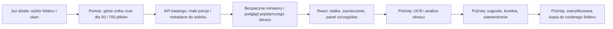

# ScreenSort - następny etap i wydajność

Ten dokument jest **planem do omówienia, nie implementacją**. Stan kodu i diagramy obecnej architektury opisuje [mapa architektury](diagramy-architektury.md). Wersja do telefonu: [PDF](../output/pdf/screensort-plan-wydajnosc.pdf).

## Najbliższy sensowny etap

Proponowany następny widoczny dla użytkownika fragment to **katalog podobny do eksploratora plików**: siatka miniatur, wybór jednego zdjęcia, większy podgląd i panel metadanych. Dopiero na takiej podstawie łatwo będzie później pokazać OCR, tagi, propozycję nazwy i decyzję użytkownika.

### Zakres proponowanego kroku

1. **Uzgodnić ekran.** Siatka z nazwą, miniaturą, typem i rozmiarem. Kliknięcie otwiera duży podgląd oraz istniejące metadane. Osobno pokazać stan skanowania i odrzucone pliki.
2. **Zmierzyć czas.** Osobno walidacja/listowanie, odczyt obrazu, SHA-256, operacje bazy, odpowiedź API oraz renderowanie Reacta. Porównać pierwszy i drugi skan oraz mały i większy folder. Kilkanaście sekund przy 700 plikach to obserwacja, nie diagnoza przyczyny.
3. **Odczytywać katalog porcjami.** Dodać stronicowanie lub podobny mechanizm po stronie bazy/API, aby React nie pobierał i nie renderował wszystkich wierszy naraz. Dla bardzo głębokich stron można później rozważyć podejście oparte na ostatnim widzianym kluczu.
4. **Zaprojektować bezpieczny podgląd.** Java może dostarczać miniaturę i pojedynczy obraz tylko po sprawdzeniu, że żądanie dotyczy wpisu w dozwolonym folderze. React nie dostaje ogólnego dostępu do dowolnej ścieżki systemowej. Źródłowe pliki pozostają tylko do odczytu.
5. **Dopiero potem optymalizować skan.** Na podstawie pomiaru zdecydować, czy pierwszym zyskiem będzie strumieniowe hashowanie, pomijanie niezmienionych plików, mniej zapytań do bazy, ograniczona równoległość, czy raportowanie postępu. Każda zmiana potrzebuje testów bezpieczeństwa i poprawności.

## Gdzie może znikać czas obecnego skanu

To są **hipotezy z kodu**, nie wyniki profilera:

| Etap | Co widać w kodzie | Możliwy koszt |
|---|---|---|
| Rozpoznanie obrazu | `ImageIO.read` dekoduje obraz do sprawdzenia, czy jest czytelny. | Odczyt i dekodowanie każdego pliku. |
| SHA-256 | `Files.readAllBytes` wczytuje cały plik, potem obliczany jest hash. | Ponowny odczyt pliku i pamięć proporcjonalna do jego rozmiaru. |
| Zapis katalogu | Dla każdego zaakceptowanego obrazu następuje szukanie rekordu i jego zapis/aktualizacja. | Wiele operacji bazy przy dużym folderze. |
| Odczyt katalogu | `findAllByAllowedRootOrderByRelativePathAsc` pobiera całą listę. | Więcej danych w pamięci, JSON i sieci lokalnej. |
| Widok Reacta | `.map()` renderuje wszystkie elementy wyniku i katalogu. | Dużo elementów DOM; szczególnie ważne po dodaniu miniatur. |

Źródła w projekcie: [`ImageScanner`](../src/main/java/pl/pum/screensort/scanning/image/ImageScanner.java), [`FileHasher`](../src/main/java/pl/pum/screensort/scanning/hashing/FileHasher.java), [`CatalogUpdater`](../src/main/java/pl/pum/screensort/catalog/CatalogUpdater.java), [`CatalogReader`](../src/main/java/pl/pum/screensort/catalog/CatalogReader.java), [`App.tsx`](../frontend/src/App.tsx).

## Czy zmienić `ArrayList` na inną strukturę?

**Na razie nie.** Skaner tylko dopisuje zaakceptowane i odrzucone elementy, a potem je iteruje. `ArrayList` pasuje do tego zadania. Samo zastąpienie jej `LinkedList`, `HashSet` lub `TreeMap` nie usuwa kosztu czytania obrazów, hashowania ani zapytań SQL.

| Struktura | Kiedy jest przydatna | Czy pomaga teraz? |
|---|---|---|
| `ArrayList` | Zachowanie kolejności, dopisywanie i iteracja. | Tak - obecny wybór jest sensowny. |
| `LinkedList` | Specyficzne operacje na końcach lub przez iterator. Indeksowanie przechodzi przez węzły i wymaga dodatkowej pamięci na połączenia. | Nie w tym przepływie. |
| `HashSet` | Szybkie sprawdzenie, czy element jest już w zbiorze; bez gwarancji kolejności. | Dopiero przy konkretnej potrzebie unikalności w pamięci. |
| `HashMap` | Szybkie znalezienie wartości po kluczu w pamięci, kosztem dodatkowej pamięci. | Potencjalnie przy batchowym porównywaniu, ale najpierw zmierzyć bazę. |
| `TreeSet` / `TreeMap` | Utrzymywanie kluczy w porządku; operacje zwykle `O(log n)`. | Nie, gdy lista jest sortowana przez bazę. |
| Posortowana lista + wyszukiwanie binarne | Wielokrotne wyszukiwanie po **tym samym posortowanym kluczu**. | Nie zastępuje indeksu PostgreSQL ani odczytu plików. |

W bazie już są `UNIQUE (allowed_root_id, relative_path)` i indeks `sha256` w [migracji V3](../src/main/resources/db/migration/V3__create_file_record.sql). `HashMap` w Javie nie jest zamiennikiem indeksu PostgreSQL. Stronicowanie rozwiązuje inny problem: ogranicza ilość danych pobranych i wyświetlonych **naraz**; nie przyspiesza automatycznie samego skanowania plików.

## Dalej: analiza i organizacja

Po czytelnym katalogu i bezpiecznym podglądzie można dodać zadania OCR oraz analizy obrazu, najlepiej z własnym statusem i widocznym błędem/retry. Ich wynik zasili propozycję nazwy, kategorii i tagów. Użytkownik zobaczy zdjęcie obok propozycji, poprawi ją i zatwierdzi. Dopiero po zatwierdzeniu osobny moduł wykona **kopię** do wybranego folderu wynikowego, zweryfikuje hash i zostawi oryginał nietknięty - zgodnie z [ADR-001](adr/ADR-001-copy-first.md). Te moduły są planem, a nie istniejącym kodem.

Równolegle, przed wydaniem instalatora, Tauri będzie musiało uruchamiać lub odnajdywać lokalną Javę, a produkt potrzebuje rozwiązania bazy niewymagającego Docker Desktop u zwykłego użytkownika. Obecna wersja Tauri ma tylko okno i natywny picker: [ADR-003](adr/ADR-003-tauri-desktop-shell.md).

## Źródła techniczne

- [Java 25: `ArrayList`](https://docs.oracle.com/en/java/javase/25/docs/api/java.base/java/util/ArrayList.html), [`LinkedList`](https://docs.oracle.com/en/java/javase/25/docs/api/java.base/java/util/LinkedList.html), [`HashMap`](https://docs.oracle.com/en/java/javase/25/docs/api/java.base/java/util/HashMap.html).
- [Spring Data JPA: porcjowanie wyników i koszty różnych metod](https://docs.spring.io/spring-data/jpa/reference/repositories/query-methods-details.html).
- [React: renderowanie list](https://react.dev/learn/rendering-lists).
